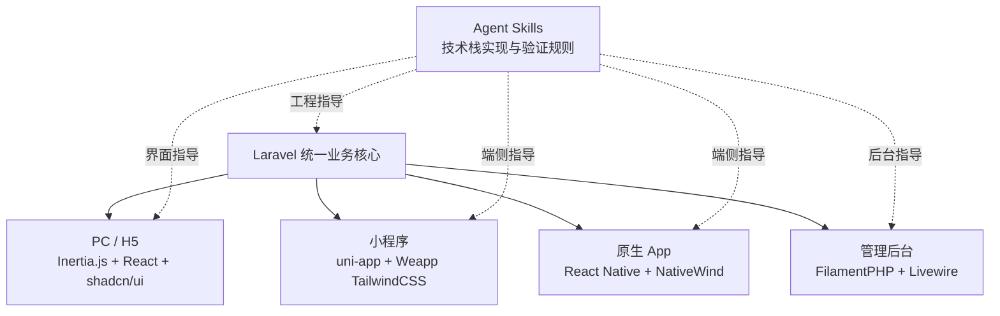

<p align="center">
  <a href="./README.md">English</a>
  ·
  <strong>简体中文</strong>
</p>

<p align="center">
  
</p>

<h1 align="center">Laravel Scaffold</h1>

<p align="center">
  以 Laravel 为统一业务后端，覆盖 Web、小程序、原生 App 与管理后台的全端应用脚手架。
</p>

<p align="center">
  <a href="#快速开始">快速开始</a>
  ·
  <a href="#项目结构">项目结构</a>
  ·
  <a href="#质量检查">质量检查</a>
</p>

## 项目定位

Laravel Scaffold 用一套 Laravel 业务核心连接不同类型的客户端。后端集中处理数据模型、身份认证、权限、接口和业务规则，各端则选择更适合自身平台的界面技术并独立演进。

- PC / H5：Inertia.js + React + shadcn/ui
- 小程序：uni-app + Vue + Weapp TailwindCSS
- 原生 App：React Native + Expo + NativeWind
- 管理后台：FilamentPHP + Livewire
- 多语言：Laravel Lang，内置中文、英文、日文
- 开发约束：面向不同技术栈的专业 Agent Skills

> Laravel Scaffold 是应用开发基础架构，不是可直接上线的完整产品。部署真实业务前，请替换内置的演示认证流程，并完成所有生产准备检查。

## 架构概览



## 技术栈

| 分层 | 主要技术 | 职责 |
| --- | --- | --- |
| 业务后端 | Laravel 13.38、PHP 8.4、Sanctum | 模型、认证、API、业务规则、队列与数据访问 |
| PC / H5 | Inertia.js 3、React 19.3、shadcn/ui、Tailwind CSS 4 | 响应式 Web 界面与组件系统 |
| 管理后台 | Filament 5.10、Livewire 4 | 数据管理、运营配置、表单、表格与 Dashboard |
| 小程序 | uni-app、Vue 3、Weapp TailwindCSS 5 | 微信及其他小程序平台的跨端页面与样式 |
| 原生 App | Expo 58、React Native 0.88、NativeWind | iOS / Android 原生应用体验 |
| 国际化 | Laravel Lang | 服务端管理中文、英文和日文文案 |
| 工程质量 | PHPUnit、Larastan、Laravel Pint、GitHub Actions | 测试、静态分析、格式检查和持续集成 |

## 已提供的基础能力

- Laravel 统一后端与标准化 JSON API 响应。
- Sanctum 登录认证及受保护的用户接口示例。
- Inertia.js + React 首页和响应式组件体系。
- 浅色、深色、跟随系统三种主题模式。
- 中文、英文、日文界面切换，并通过 Session 保存选择。
- Filament 管理面板及用户资源示例。
- uni-app 多平台小程序基础工程。
- Expo / React Native 原生 App 基础工程。
- 五类专业 Agent Skills 的版本锁定信息。

> 这是面向业务开发的基础架构。具体领域模型、页面、权限和业务流程应在此基础上按项目需求实现。

## 项目结构

```text
Scaffold/
├── composer.json             # 根目录安装、开发与检查命令
├── LICENSE                   # MIT 开源协议
├── scaffold.json             # 三端应用安装清单
├── scripts/install.php       # 配置驱动的一键安装器
├── Console/                 # Laravel 后端、PC / H5 和 Filament 管理后台
│   ├── app/                 # 模型、控制器、业务逻辑、中间件与 Filament 资源
│   ├── lang/                # Laravel Lang：zh_CN、en、ja
│   ├── resources/js/        # Inertia.js + React 页面与组件
│   ├── resources/css/       # Web 与 Filament 样式
│   ├── routes/              # Web、API 和命令路由
│   └── tests/               # Laravel 自动化测试
├── Applet/                  # uni-app + Vue + Weapp TailwindCSS
│   └── src/                 # 小程序页面、入口与平台配置
├── App/                     # Expo + React Native + NativeWind
│   ├── components/          # App 组件
│   └── assets/              # 图标、启动图等原生资源
├── Docs/                    # 产品与项目文档
├── skills-lock.json         # Agent Skills 来源与版本锁定
├── README.md                # English documentation
└── README.zh-CN.md          # 简体中文文档
```

## 环境要求

- PHP 8.4+
- Composer 2
- Node.js 24.19.0 LTS（兼容范围 `>=24.11.0 <25`）与 npm 12
- SQLite（默认）或 Laravel 支持的其他数据库
- 小程序开发时需要相应平台开发者工具
- iOS / Android 本地构建需要 Xcode 或 Android Studio

仓库根目录提供 `.nvmrc`。使用 nvm 时可在任意子项目安装依赖前执行：

```bash
nvm install
nvm use
node --version
npm --version
```

三个前端工程均启用了 npm `engine-strict`。若版本不符合要求，依赖安装会直接终止，请先切换到 `.nvmrc` 指定的版本。

## 快速开始

### 1. 创建并初始化完整工程

发布到 Packagist 后，可通过一条命令创建完整的多端工程：

```bash
composer create-project hnher/scaffold MyProject
cd MyProject
```

该命令会按照根目录 `scaffold.json` 的安装清单完成以下操作：

- 为 `Console`、`App` 和 `Applet` 创建本地环境文件，同时保留已经存在的配置。
- 安装 Laravel Composer 依赖，创建 SQLite 数据库，生成应用密钥并执行迁移。
- 使用各端锁文件安装 Node.js 依赖，并构建 Laravel Web 资源。

直接克隆仓库时，可在根目录执行相同的初始化流程：

```bash
composer setup
```

只安装 PHP 依赖时可以执行 `composer setup:no-node`。安装器还支持 `--no-migrate` 和 `--dry-run`：

```bash
php scripts/install.php --no-migrate
php scripts/install.php --dry-run
```

### 2. 启动 Laravel、PC / H5 与管理后台

```bash
composer dev
```

根目录的 `composer dev` 会转发到 `Console`，启动 Laravel 与 Web 开发服务。

默认访问地址：

- Web 首页：`http://localhost:8000`
- Filament 管理后台：`http://localhost:8000/console`
- 健康检查：`http://localhost:8000/up`

脚手架不提供默认管理员或固定密码。如需初始化管理员，在被 Git 忽略的 `Console/.env` 中设置 `SEED_ADMIN_EMAIL` 和 `SEED_ADMIN_PASSWORD`，然后在 `Console` 执行 `php artisan db:seed --class=UserSeeder`。已有账号不会被覆盖，创建完成后请移除环境中的初始化密码。

### 3. 启动小程序工程

```bash
cd Applet
npm run dev:mp-weixin
```

常用的其他命令：

```bash
npm run dev:h5
npm run build:mp-weixin
npm run build:h5
```

首次运行前，请在 `Applet/src/manifest.json` 中填写目标平台的应用信息。

通过 CI 上传微信小程序时，在 `Applet/.env` 或 CI 环境变量中设置 `WECHAT_APP_ID` 与 `WECHAT_PRIVATE_KEY_PATH`。上传私钥必须保存在 Git 之外，路径支持绝对路径。构建完成后执行 `npm run upload:mp-weixin`；上传命令会读取本地 `.env`，缺少 AppID 或私钥时会停止。

### 4. 启动原生 App

```bash
cd App
npm start
```

也可以直接启动指定平台：

```bash
npm run ios
npm run android
npm run web
```

发布前请更新 `App/app.json` 中的应用名称、标识、图标和原生平台配置。

模板未绑定 Expo、Apple 或 Firebase 账号。在 `App` 目录执行 `eas init` 关联自己的 EAS 项目；如需 OTA 更新，再执行 `eas update:configure`。在 `App/eas.json` 中配置自己的应用提交信息。Android 推送需要提供被 Git 忽略的 `App/google-services.json`，通过 `expo.android.googleServicesFile` 引用，并在 EAS 中配置 FCM 凭据。服务账号私钥和签名凭据不得提交到 Git。

升级 Expo SDK 58 后，需要通过 `npm run ios` 或 `npm run android` 重新构建开发客户端，旧 SDK 56 安装包无法运行新的原生依赖。如果本地已生成原生工程，请先检查其中的手动修改，再执行 `npm run prebuild` 重新生成原生目录。OTA 更新现已采用 `fingerprint` 运行时策略，确保更新只匹配兼容的原生安装包。

## 多语言与主题

Web 首页的文案由 Laravel Lang 提供，而不是在 React 组件中维护独立语言包：

```text
Console/lang/zh_CN/home.php
Console/lang/en/home.php
Console/lang/ja/home.php
```

支持的语言在 `Console/config/app.php` 的 `supported_locales` 中配置。语言选择通过 `POST /locale` 写入 Session，再由 `SetLocale` 中间件设置当前 Laravel Locale。

主题支持浅色、深色和跟随系统，用户选择保存在浏览器本地存储中。

## API 基础

当前提供以下认证与用户接口示例：

```text
POST /api/auth/login
POST /api/auth/logout     # auth:sanctum
GET  /api/user/profile    # auth:sanctum
GET  /api/user/getList    # auth:sanctum
```

当前登录接口用于演示，会为数据库中的首位用户签发 Token，不校验邮箱和密码。App 与小程序首页提供一键演示登录，登录成功后自动获取当前 Token 对应的个人信息，并支持刷新、会话恢复和退出。

API 异常会统一转换为包含 `code`、`message`、`datetime`、`data` 和可选 `errors` 的 JSON 响应。新增接口时应继续沿用现有认证、验证和响应约定。

### 三端网络请求

三端请求层都支持 GET、POST、Bearer Token、语言头、15 秒超时、统一响应解包和自动异常 Toast：

```javascript
// Web / H5
import { userApi } from '@/services/api'

const profile = await userApi.profile()
```

```typescript
// React Native
import { userApi } from './services/api'

const profile = await userApi.profile()
```

```javascript
// uni-app / 小程序
import { userApi } from '@/services/api'

const profile = await userApi.profile()
```

服务端异常默认由各端独立 Toast 显示。表单需要自行展示逐字段错误时，可传入 `{ showErrorToast: false }`，并从抛出的 `ApiError.errors` 中读取错误信息。

- Web / H5 默认使用同源 `/api`，也可以通过 `Console/.env` 的 `VITE_API_BASE_URL` 覆盖。
- App 通过 `EXPO_PUBLIC_API_BASE_URL` 配置，Token 使用系统安全存储持久化。
- 小程序通过 `VITE_API_BASE_URL` 配置，并需要在对应小程序后台配置合法请求域名。
- 真机不能使用 `127.0.0.1` 访问电脑上的 Laravel 服务，请改为局域网地址或 HTTPS 开发域名。

## 生产准备与安全

- 将演示登录接口替换为真实的凭据验证、频率限制、Token 生命周期规则和账号状态检查。
- 为 Filament 面板、API 操作、模型和业务数据配置明确的访问权限。
- 将应用密钥、签名凭据、平台密钥和生产环境文件保存在版本控制之外。
- 替换示例 Bundle ID、包名、小程序 AppID、域名、图标和应用元数据。
- 替换部署示例、robots.txt 和 sitemap.xml 中的 `scaffold.example.com`。生产环境文件和凭据需由部署环境提供，不随模板分发。
- 根据目标环境配置 HTTPS、CORS、可信主机、平台请求域名、队列、日志、备份和监控。

## Agent Skills

`skills-lock.json` 记录了项目使用的专业 Skills 来源与版本：

| Skill | 适用范围 |
| --- | --- |
| `laravel-specialist` | Laravel 模型、API、认证、队列与测试 |
| `shadcn` | React 组件、设计令牌与无障碍实现 |
| `filament-pro` | Filament Resource、Form、Table 与 Widget |
| `uni-app` | 小程序跨平台开发与兼容性 |
| `ui-ux-pro-max` | 配色、响应式布局、交互与体验检查 |

## 质量检查

### Laravel / Web

```bash
cd Console
composer lint:check
composer types:check
php artisan test
npm run build
```

执行完整后端检查：

```bash
composer test
```

### React Native

```bash
cd App
npm run lint
npm run types:check
npx expo install --check
npx expo-doctor@latest
```

持续集成环境也应读取仓库根目录的 `.nvmrc`，确保本机与构建环境使用一致的 Node.js 版本。

### 小程序上传配置

```bash
cd Applet
npm test
```

## 开发原则

- 业务规则、权限和数据一致性优先放在 Laravel 后端。
- 各客户端共享认证、API 和数据约定，不共享不适合平台的界面实现。
- 用户可见文案优先通过 Laravel Lang 管理。
- 新增界面应同时验证响应式布局、深色模式和减少动态效果设置。
- 提交前至少完成对应端的构建、格式检查和自动化测试。

## 开源协议

Laravel Scaffold 基于 [MIT License](./LICENSE) 开源。
